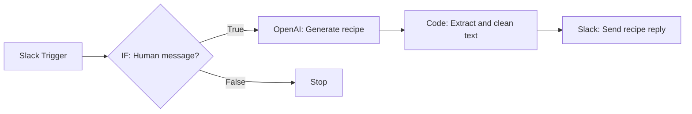

# N8N Slack Recipe Generator 🍽️

An AI-powered Slack bot built with **self-hosted n8n** that turns
messages in a Slack channel into practical recipe suggestions.

A user posts a recipe request in Slack. The workflow filters out bot
messages, asks an OpenAI model to generate a recipe, cleans up the
response, and posts the recipe back into the channel.

## Workflow at a glance



**Flow:** Slack Trigger → IF Filter → OpenAI → Code → Slack Reply

## Features

-   Responds to recipe requests posted in Slack.
-   Generates ingredients with quantities and numbered cooking
    instructions.
-   Includes preparation time, cooking time, total time, servings, and
    difficulty.
-   Adds two cooking tips and dietary notes.
-   Can adapt recipes to ingredients, cuisine, spice level, and serving
    size mentioned by the user.
-   Filters bot-generated messages to prevent an infinite reply loop.
-   Cleans up the model response before posting it to Slack.

## Tech stack

-   [n8n](https://n8n.io/) --- workflow automation, self-hosted on a VPS
-   [Slack API](https://api.slack.com/) --- message events and channel
    replies
-   [OpenAI API](https://platform.openai.com/) --- recipe generation
-   JavaScript --- response extraction and text cleanup in an n8n Code
    node

## Workflow nodes

### 1. Slack Trigger

Listens for new messages in the target Slack channel.

Configuration notes: - Select the channel where the bot should
respond. - Configure Slack event subscriptions and the appropriate bot
event. - Use the n8n **Production URL** for live operation. - Invite the
Slack bot to the channel.

### 2. IF --- Filter human messages

The IF node prevents the bot from replying to its own messages.

Example Boolean expression:

``` javascript
{{ !!$json.user && !$json.bot_id && $json.subtype !== "bot_message" }}
```

Route the **true** output to OpenAI. Leave the **false** output
unconnected if messages that fail the filter should be ignored.

> Verify the event fields from your Slack Trigger output before reusing
> this expression in a different Slack event configuration.

### 3. OpenAI --- Message a Model

Generates the recipe from the incoming Slack message.

Typical user-message expression:

``` javascript
{{ $json.text }}
```

Suggested system-prompt requirements: - Always include a recipe name and
short description. - Include preparation, cooking, and total time;
servings; and difficulty. - List ingredients with quantities. - Provide
numbered instructions. - Include exactly two cooking tips and dietary
notes. - Adapt to stated ingredients, preferences, cuisine, spice level,
and serving size. - Use clear plain text suitable for Slack.

Output randomness (temperature) was set to `0.2` during testing. This
can make responses more predictable, but it does not guarantee a
perfectly consistent format.

### 4. Code --- Extract and clean the response

The Code node extracts the generated text from the OpenAI response,
removes common Markdown formatting, normalizes whitespace, and outputs a
`recipe` field.

Example code for the response shape used in this project:

``` javascript
const response = $input.first().json;

// Find the generated message and its text content.
const recipeText = response.output
  ?.find(item => item.type === 'message')
  ?.content
  ?.find(item => item.type === 'output_text')
  ?.text;

if (!recipeText) {
  throw new Error('No recipe text found in the OpenAI response.');
}

// Remove common Markdown formatting and excess blank lines.
const cleanText = recipeText
  .replace(/\r\n/g, '\n')
  .replace(/\*\*(.*?)\*\*/g, '$1')
  .replace(/^#{1,6}\s*/gm, '')
  .replace(/^\s*---+\s*$/gm, '')
  .replace(/[ \t]+$/gm, '')
  .replace(/\n{3,}/g, '\n\n')
  .trim();

// Pass the cleaned recipe to the next node.
return [{
  json: {
    recipe: cleanText
  }
}];
```

**Important:** OpenAI node output structures can vary by node version
and API operation. If your output shape differs, inspect the node's
execution data and adjust the extraction paths.

### 5. Slack --- Send Message

Posts the cleaned recipe back to the channel.

Message text expression:

``` javascript
{{ $json.recipe }}
```

The workflow's Slack attribution/footer option was disabled where
available.

## Slack app setup

Configure a Slack app with the permissions and event subscriptions
needed by your workspace. In this project, the relevant bot scopes were:

-   `channels:history`
-   `channels:read`
-   `chat:write`

The app subscribed to the `message.channels` bot event and was
installed/reinstalled after scope changes. Your own workspace may
require different scopes depending on channel type and app
configuration.

After installing or changing scopes: 1. Reinstall the app to the
workspace if Slack requests it. 2. Invite the bot to the target channel.
3. Configure and verify the n8n production webhook URL in Slack Event
Subscriptions. 4. Publish/activate the workflow in n8n.

**Security:** Never commit Slack bot tokens, OpenAI API keys, OAuth
secrets, webhook secrets, or exported credential data to GitHub. Store
credentials in n8n's credential manager and use placeholders in public
examples.

## Test the workflow

1.  Save the workflow and test each node using sample Slack message
    data.
2.  Confirm the IF node passes a human message.
3.  Confirm the OpenAI node returns generated recipe text.
4.  Confirm the Code node outputs `recipe`.
5.  Confirm the Slack node posts that field to the channel.
6.  Test with a real message after configuring the Slack production URL
    and activating the workflow.
7.  Verify the bot sends only one reply per human request.

Example test message:

> Give me a spicy vegetarian potato and onion recipe for 2 people.
> Include preparation time, cooking time, total time, servings,
> difficulty, ingredients, numbered instructions, exactly 2 cooking
> tips, and dietary notes.

## Troubleshooting

  -----------------------------------------------------------------------
  Problem                             What to check
  ----------------------------------- -----------------------------------
  Slack event does not trigger n8n    Confirm the production URL,
                                      workflow activation, event
                                      subscription verification, and bot
                                      event subscriptions.

  Bot does not see channel messages   Confirm the app has the required
                                      scopes and is invited to the
                                      channel.

  Bot replies to itself repeatedly    Check that the IF filter is between
                                      the Slack Trigger and OpenAI, and
                                      that its true output is the only
                                      route to the AI.

  Recipe text is empty                Inspect the OpenAI node's output
                                      and update the Code node's
                                      extraction path if the response
                                      schema differs.

  Slack message is empty              Confirm the Code node returns
                                      `json.recipe` and the Slack node
                                      uses `{{ $json.recipe }}`.

  Recipe omits a section              Strengthen the system prompt and
                                      test again; prompting guides the
                                      model but does not strictly enforce
                                      a schema.
  -----------------------------------------------------------------------

## Ideas for future improvements

-   Ingredient-based recipe suggestions.
-   Dietary preference controls (vegan, vegetarian, high-protein, and
    more).
-   A `/recipe` Slack slash command.
-   Error handling and user-friendly failure messages.
-   Structured output validation before sending the Slack response.
-   Optional logging of requests and execution results.

## Learning outcomes

This project demonstrates how to: - Build a trigger-based n8n
workflow. - Connect Slack and OpenAI using credentials. - Filter events
with an IF node. - Use expressions such as `{{ $json.text }}` and
`{{ $json.recipe }}`. - Read nested API output in a Code node. - Clean
generated text with JavaScript. - Test a workflow, switch from a test
webhook to a production webhook, and activate it. - Prevent event-driven
automation loops.

## Repository contents

Suggested GitHub repository layout:

``` text
n8n-slack-recipe-generator/
├── README.md
├── workflow/
│   └── slack-recipe-generator.json
├── images/
│   └── n8n-slack-recipe-generator-blueprint.png
└── .gitignore
```

Add your exported workflow JSON and blueprint image to those folders if
you want to include them. Before committing an exported workflow, check
it for credentials, tokens, internal URLs, and other private details.

